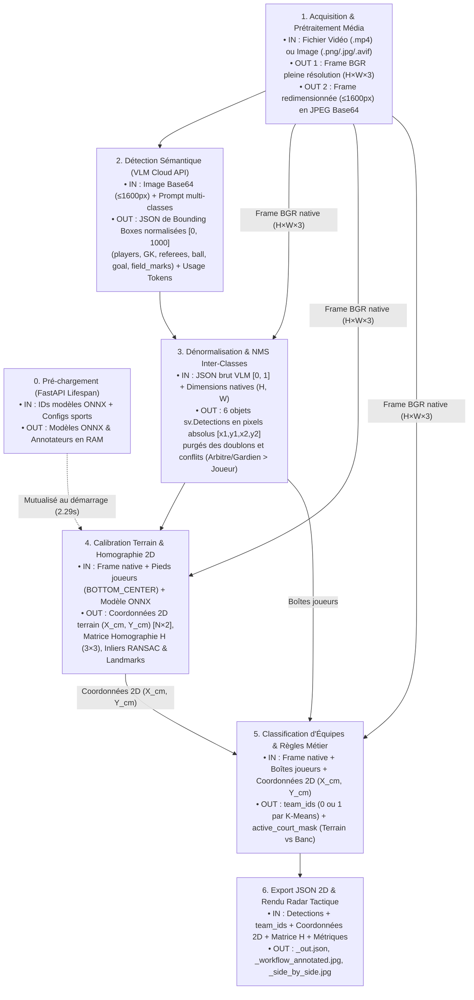
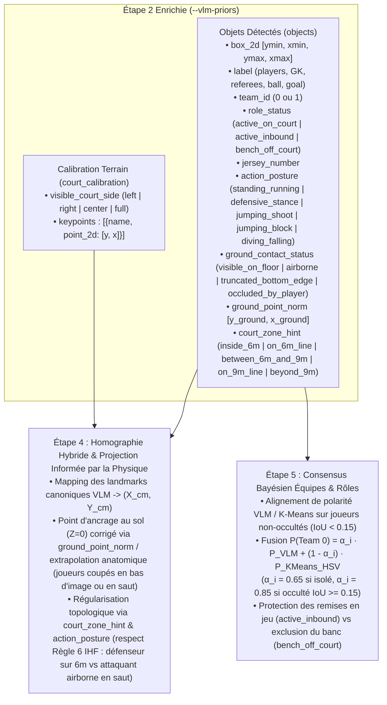

# Architecture du Pipeline : De l'Image Brute aux Coordonnées 2D par Homographie

Ce document décrit de bout en bout la chaîne de traitement permettant d'extraire, à partir d'une image ou d'une vidéo de sport collectif (`Basket`, `Football`, `Handball`, `Football Américain`), les boîtes englobantes sémantiques, l'appartenance aux équipes, et les **coordonnées topographiques 2D en centimètres** sur le terrain via calibration homographique.

---

## 1. Vue Haut Niveau (Macro-Étapes & Flux d'Entrées/Sorties)



### Tableau Récapitulatif des Macro-Étapes (Inputs, Outputs, Nature, Lieu & Temps)

> [!NOTE]
> Les pourcentages de temps ci-dessous sont issus des mesures réelles sur la campagne de benchmark multi-sports (**36 médias**, temps cumulé hors initialisation de **342.22s**, soit **9.51s/média** en moyenne globale et **6.05s/média** avec `thinkingBudget=1024`). L'initialisation au démarrage (**2.29s**) est exécutée une seule fois au lancement du serveur FastAPI et est donc amortie (0% du temps par requête chaude).

| Macro-Étape | Programme & Fonction Principale | Entrées (Inputs) | Sorties (Outputs) | Nature du Traitement | Lieu d'Exécution | Poids (%) |
| :--- | :--- | :--- | :--- | :--- | :--- | :---: |
| **0. Initialisation Lifespan** | [`run_batch_sports.py :: main()`](../src/run_batch_sports.py#L100-L123) | • IDs modèles Roboflow (`basketball-court-detection-2/14`, `football-field-detection-f07vi/14`)<br>• Clé `ROBOFLOW_API_KEY` | • `court_models` : Modèles ONNX chargés et *warmed-up* en RAM/VRAM<br>• `annotators` : 4 instances `SportsAnnotator` | **ML/DL** (Chargement ONNX Runtime + passe à vide) | **Local** (1er téléchargement depuis `api.roboflow.com`) | *Amorti (0%)*<br>*(2.29s 1x)* |
| **1. Acquisition & Encodage** | [`run_batch_sports.py :: extract_best_video_frame()`](../src/run_batch_sports.py#L38-L75)<br>[`workflow_adapter.py :: read_image_robust()`](../src/workflow_adapter.py#L19-L43) | • Chemin fichier vidéo (`.mp4`) ou image (`.png`, `.jpg`, `.avif`)<br>• Paramètre `mode="high"` | • **Locale :** `frame` (`np.ndarray` BGR pleine résolution $H \times W \times 3$)<br>• **Pour VLM :** Image redimensionnée ($\le 1600\text{ px}$), compressée JPEG Q90 en `Base64` | **Mathématique & Traitement d'image** (Laplacien, Resize, JPEG Base64) | **100 % Local** (CPU - OpenCV / FFmpeg) | **~0.15 %**<br>*(10–15 ms)* |
| **2. Détection Sémantique Multi-Classes** | [`workflow_adapter.py :: call_gemini_direct()`](../src/workflow_adapter.py#L131-L265)<br>[`workflow_adapter.py :: call_openai_direct()`](../src/workflow_adapter.py#L324-L433) | • Image **pré-traitée** ($\le 1600\text{ px}$, JPEG Base64)<br>• Prompt spécifique au sport listant les classes (`players`, `goalkeepers`, `referees`, `ball`, `goal`/`basket`, `field_marks`)<br>• Config `MEDIA_RESOLUTION_HIGH` + `thinkingBudget=1024` | • **Uniquement des Bounding Boxes JSON** normalisées (`box_2d: [ymin, xmin, ymax, xmax]` sur $[0, 1000]$) converties en $[0, 1]$ avec leur `class` (incluant des boîtes pour `field_marks`, **mais aucun keypoint ponctuel**)<br>• `usage` : décompte exact des tokens (`prompt`, `thoughts`, `output`) | **VLM / LLM Multimodal** (Fondation Vision-Language en Zero-Shot) | **100 % Serveur Déporté (Cloud)**<br>• Google (`generativelanguage.googleapis.com`)<br>• OpenAI (`api.openai.com`) | **96.87 %**<br>*(~5.6s à 9.2s)* |
| **3. Normalisation & NMS Inter-Classes** | [`workflow_adapter.py :: parse_predictions()`](../src/workflow_adapter.py#L435-L574) | • Dict JSON des boîtes normalisées $[0, 1]$ de l'Étape 2<br>• Dimensions originales `(frame_h, frame_w)` | • Dict de 6 objets `sv.Detections` en **pixels absolus** `[x1, y1, x2, y2]` (`players`, `goalkeepers`, `referees`, `ball`, `basket`, `field_marks`) filtrés par taille ($\ge 50\times 60\text{ px}$), NMS intra-classe et IoU inter-classes | **Mathématique / Géométrie** (Mise à l'échelle, IoU matriciel, NMS) | **100 % Local** (CPU - NumPy / Supervision) | **~0.05 %**<br>*(2–5 ms)* |
| **4. Calibration Terrain & Homographie 2D** | [`analyze_image.py :: analyze_image_workflow()`](../src/analyze_image.py#L418-L484)<br>[`court_homography.py :: CourtHomographyCalculator`](../src/court_homography.py#L18-L162) | • `frame` BGR **pleine résolution**<br>• Boîtes `player_detections` $\to$ extraction des pieds `BOTTOM_CENTER` $(u, v)$ en pixels<br>• Modèle ONNX (`Basket`/`Foot`) ou dimensions terrain (`Handball`/`US Football`) | • `transformed_player_pts` : Coordonnées 2D terrain $(X_{\text{cm}}, Y_{\text{cm}})$ de taille $N \times 2$<br>• `matrix` : Matrice d'homographie $H$ ($3\times 3$) et `inliers` RANSAC<br>• `landmarks` : Liste des keypoints terrain `{id, label, x, y, confidence}` | **Hybride ML/DL + Mathématique**<br>• **ML/DL :** Réseau de neurones ONNX (32–33 keypoints)<br>• **Maths :** RANSAC `findHomography` ou projection perspective analytique | **100 % Local** (ONNX Runtime CPU/GPU + OpenCV C++) | **2.51 %**<br>*(180–240 ms ONNX / <2 ms proj.)* |
| **5. Classification d'Équipes & Filtrage Terrain** | [`workflow_adapter.py :: classify_player_teams()`](../src/workflow_adapter.py#L593-L709)<br>[`analyze_image.py :: analyze_image_workflow()`](../src/analyze_image.py#L486-L502) | • `frame` BGR pleine résolution (pour découpe des torses)<br>• Boîtes `player_detections`<br>• Coordonnées 2D `transformed_player_pts` $(X_{\text{cm}}, Y_{\text{cm}})$ | • `team_ids` : Liste `List[int]` affectant chaque joueur à `0` (équipe claire/colorée) ou `1` (équipe foncée)<br>• `active_court_mask` : Masque booléen $N$ distinguant les joueurs sur le terrain (`True`) des remplaçants/banc (`False` / `Bench`) | **ML Non-Supervisé + Mathématique**<br>• **ML :** Double `K-Means` ($K=2$)<br>• **Maths :** Espace HSV, produit scalaire, bornes topologiques | **100 % Local** (CPU - Scikit-Learn / OpenCV / NumPy) | **0.46 %**<br>*(40–65 ms)* |
| **6. Sérialisation JSON & Rendu Radar 2D** | [`analyze_image.py :: analyze_image_workflow()`](../src/analyze_image.py#L511-L702)<br>[`visualization.py :: SportsAnnotator`](../src/visualization.py#L22-L384) | • Toutes les sorties des étapes 1 à 5 (`frame`, `Detections`, `team_ids`, `active_court_mask`, `transformed_player_pts`, `matrix`, `landmarks`, temps, tokens) | • `<stem>_out.json` : JSON structuré final avec `court_position_cm: [X, Y]`<br>• `<stem>_workflow_annotated.jpg` : Image + Bboxes + Radar PiP<br>• `<stem>_side_by_side.jpg` : Vue composite `[Bboxes \| Radar 2D]` | **Mathématique & Graphique Vectoriel** (Tracés OpenCV, alpha-blending) | **100 % Local** (CPU - OpenCV / Supervision) | *Post-pipeline*<br>*(50–80 ms)* |

---

## 2. Description Détaillée Étape par Étape (avec Spécification des Inputs / Outputs)

### Étape 0 : Pré-chargement Mutualisé (FastAPI Lifespan)
* **Où (Programme & Fonctions) :**
  * [`src/run_batch_sports.py` — `main()` (lignes 100 à 123)](../src/run_batch_sports.py#L100-L123)
  * [`src/visualization.py` — `SportsAnnotator.__init__()` (lignes 27 à 67)](../src/visualization.py#L27-L67)
* **Inputs (Entrées) :**
  * Identifiants des modèles Roboflow de détection de terrain : `basketball-court-detection-2/14` (Basket) et `football-field-detection-f07vi/14` (Football).
  * Clé d'API `ROBOFLOW_API_KEY` (via `.env`).
  * Configurations géométriques des 4 sports (`SPORTS_CONFIGS` dans [`src/sports_config.py`](../src/sports_config.py#L19-L104)).
* **Outputs (Sorties) :**
  * Dictionnaire `court_models` contenant les sessions ONNX Runtime initialisées et pré-chauffées en RAM/VRAM.
  * Dictionnaire `annotators` contenant les 4 instances de `SportsAnnotator` avec leurs sommets de référence (`vertices` en cm).
* **Nature du traitement :** **Librairie ML/DL** (`inference` / ONNX Runtime). Chargement des poids et exécution d'une passe d'inférence à vide (*warm-up* sur un tenseur nul `720×1280×3`).
* **Lieu d'exécution :** **Local** (téléchargement initial des poids depuis `https://api.roboflow.com` vers `~/.inference/cache` uniquement lors de la première exécution).
* **Temps estimatif :** **2.29 secondes** une seule fois au démarrage (0% du temps d'une requête chaude).

---

### Étape 1 : Acquisition Média, Contrôle Qualité Vidéo & Pré-encodage
* **Où (Programme & Fonctions) :**
  * Sélection vidéo : [`src/run_batch_sports.py` — `assess_frame_quality()` (lignes 21 à 36)](../src/run_batch_sports.py#L21-L36) et [`extract_best_video_frame()` (lignes 38 à 75)](../src/run_batch_sports.py#L38-L75).
  * Décodage image multi-format : [`src/workflow_adapter.py` — `read_image_robust()` (lignes 19 à 43)](../src/workflow_adapter.py#L19-L43).
  * Redimensionnement et compression pour le VLM : [`src/workflow_adapter.py` — `call_gemini_direct()` (lignes 149 à 161)](../src/workflow_adapter.py#L149-L161).
* **Inputs (Entrées) :**
  * Fichier média source sur disque : vidéo (`.mp4`, `.mov`, `.avi`, `.mkv`) ou image fixe (`.jpg`, `.png`, `.webp`, `.avif`).
  * Paramètre de mode : `mode="high"`.
* **Outputs (Sorties) :**
  1. **Pour les étapes locales (Étapes 3, 4, 5, 6) :** Le tenseur image **original en pleine résolution** `frame` (`np.ndarray` BGR de dimensions natives $H \times W \times 3$, ex. `1080×1920×3` ou `2160×3840×3`). Si la source est une vidéo, le fichier JPEG de la `frame 0` (ou `frame 30`) est également sauvegardé dans `out/<sport>/frames/<stem>_frame_0.jpg`.
  2. **Pour l'appel API VLM (Étape 2) :** Une image **pré-traitée** (`b64_data: str`) : redimensionnée homothétiquement pour que $\max(H, W) \le 1600\text{ px}$ (si l'image originale dépasse 1600px), compressée en JPEG (qualité `90`) et encodée en `Base64`.
* **Nature du traitement :** **Mathématique & Traitement du signal pur** (aucun LLM ni ML) :
  * Calcul de luminance ($\mu$), contraste ($\sigma$) et variance du Laplacien ($\text{Var}(\nabla^2 I)$) sur la `frame 0`. Si $\mu < 25$ ou $\sigma < 15$, bascule sur la `frame 30`.
  * Décodage OpenCV ou pipe `ffmpeg` (pour `.avif`), suivi de `cv2.resize` et `cv2.imencode('.jpg')`.
* **Lieu d'exécution :** **100 % Local** (CPU).
* **Temps estimatif :** **~0.15 %** du temps global (~10 à 15 ms par image).

---

### Étape 2 : Détection Sémantique Multi-Classes (Inférence VLM)
* **Où (Programme & Fonctions) :**
  * [`src/analyze_image.py` — `analyze_image_workflow()` (lignes 385 à 405)](../src/analyze_image.py#L385-L405)
  * [`src/workflow_adapter.py` — `call_gemini_direct()` (lignes 131 à 265)](../src/workflow_adapter.py#L131-L265)
  * [`src/workflow_adapter.py` — `call_openai_direct()` (lignes 324 à 433)](../src/workflow_adapter.py#L324-L433)
  * Définition des prompts et classes par sport : [`src/sports_config.py` — `SPORTS_CONFIGS` (lignes 20 à 104)](../src/sports_config.py#L20-L104).
* **Inputs (Entrées) :**
  1. **L'image pré-traitée** (`b64_data` : JPEG qualité 90, redimensionnée à $\le 1600\text{ px}$ sur le grand côté). *Note : le redimensionnement n'impacte pas le repérage spatial car le VLM prédit dans un référentiel relatif $[0, 1000]$ indépendant de la résolution.*
  2. **Le prompt textuel spécifique au sport** (`sport_cfg.prompt_description`), demandant la détection simultanée des classes d'acteurs/objets **et** des marquages au sol (`field_marks`) :
     * **Basket :** `players`, `referees`, `ball`, `basket`, `field_marks` (*raquette/paint, cercle des lancers-francs, ligne à 3 points, rond central*).
     * **Football :** `players`, `goalkeepers`, `referees`, `ball`, `goal`, `field_marks` (*surface de réparation, point de penalty, surface de but 6m, rond central, lignes de touche, arc de corner*).
     * **Handball :** `players`, `goalkeepers`, `referees`, `ball`, `goal`, `field_marks` (*ligne continue des 6m, ligne pointillée des 9m, trait des 7m, ligne médiane*).
     * **Football Américain :** `players`, `referees`, `ball`, `goalpost`, `field_marks` (*lignes de 5/10 yards, numéros de yards, hash marks, end-zone, lignes de touche*).
  3. **Configuration de génération (`generationConfig`) :** `response_mime_type: "application/json"`, `mediaResolution: "MEDIA_RESOLUTION_HIGH"` (1 120 tokens image), `thinkingConfig: {"thinkingBudget": 1024}`.
* **Outputs (Sorties) :**
  1. **Un tableau JSON contenant exclusivement des boîtes englobantes 2D (`box_2d`) et leur classe (`label`) — aucun keypoint ponctuel $(x, y)$ n'est produit par le VLM :**
     * Format brut renvoyé par Gemini : `[{"box_2d": [ymin, xmin, ymax, xmax], "label": "players"}, ...]` avec des entiers normalisés entre `0` et `1000`.
     * Format normalisé retourné par `call_gemini_direct()` :
       ```json
       {
         "model": {
           "predictions": [
             {"x": 0.452, "y": 0.610, "width": 0.048, "height": 0.142, "confidence": 0.95, "class": "players"},
             {"x": 0.500, "y": 0.720, "width": 0.620, "height": 0.250, "confidence": 0.95, "class": "field_marks"}
           ]
         },
         "usage": {
           "prompt_tokens": 1284,
           "thoughts_tokens": 939,
           "candidates_tokens": 450,
           "total_tokens": 2673,
           "model": "gemini-3.6-flash"
         }
       }
       ```
     > [!IMPORTANT]
     > **Distinction `field_marks` (Étape 2) vs `keypoints` (Étape 4) :** Le VLM détecte les marquages au sol sous forme de **boîtes englobantes globales** (`field_marks`, ex. boîte englobant la raquette ou une ligne de yard), mais **ne fournit pas de coordonnées ponctuelles d'intersections nommées** suffisamment précises au pixel près pour calculer directement une matrice d'homographie $3\times 3$. C'est l'Étape 4 qui extrait les keypoints ponctuels (via modèles ONNX dédiés pour Basket et Football) ou applique la projection perspective géométrique (pour Handball et Football Américain).
* **Nature du traitement :** **LLM / VLM Multimodal** (Fondation Vision-Language en Zero-Shot).
* **Lieu d'exécution :** **100 % Serveur Déporté (Cloud)** (`generativelanguage.googleapis.com`, `api.openai.com`, ou `serverless.roboflow.com`).
* **Temps estimatif :** **96.87 %** du traitement global (~5.6s avec `thinkingBudget=1024`, 9.22s en moyenne globale).

---

### Étape 3 : Dénormalisation Géométrique & Suppression Inter-Classes (NMS)
* **Où (Programme & Fonctions) :**
  * [`src/workflow_adapter.py` — `parse_predictions()` (lignes 435 à 574)](../src/workflow_adapter.py#L435-L574)
* **Inputs (Entrées) :**
  * Le dictionnaire `raw_workflow` issu de l'Étape 2 (liste de prédictions en coordonnées relatives centre/taille `x, y, width, height` $\in [0.0, 1.0]$).
  * Le tuple `image_shape = (frame_h, frame_w)` correspondant à la **résolution native** de l'image originale.
* **Outputs (Sorties) :**
  * Un dictionnaire Python `Dict[str, sv.Detections]` contenant **6 objets `supervision.Detections` distincts** dont les boîtes `.xyxy` sont exprimées en **pixels absolus `[x1, y1, x2, y2]` dans la résolution originale de l'image** :
    * `parsed_dets["players"]` : Joueurs de champ nettoyés.
    * `parsed_dets["goalkeepers"]` : Gardiens de but (`Foot`, `Handball`).
    * `parsed_dets["referees"]` : Arbitres et juges de touche.
    * `parsed_dets["ball"]` : Ballon.
    * `parsed_dets["basket"]` : Cages de but, paniers ou poteaux (`goal_or_basket`).
    * `parsed_dets["field_marks"]` : Boîtes des marquages terrain.
* **Nature du traitement :** **Mathématique & Algorithmique pur** (aucun LLM ni réseau de neurones) :
  1. **Mise à l'échelle pixel :** Multiplication par $(W, H)$ et conversion $(cx, cy, w, h) \to (x_1, y_1, x_2, y_2)$.
  2. **Filtrage morphologique :** Rejet des boîtes `players` de taille inférieure à $50 \times 60\text{ px}$ (lignes 534–542).
  3. **NMS intra-classe :** `with_nms(threshold=0.5)` sur `players` (ligne 560).
  4. **Suppression inter-classes par IoU matriciel (`sv.box_iou_batch`) :** Toute boîte `player` ayant une intersection $\text{IoU} \ge 0.5$ avec un `referee` (lignes 563–566) ou un `goalkeeper` (lignes 569–572) est supprimée pour éviter les doubles étiquetages.
* **Lieu d'exécution :** **100 % Local** (CPU via NumPy et Supervision).
* **Temps estimatif :** **~0.05 %** du temps global (~2 à 5 ms).

---

### Étape 4 : Calibration du Terrain, Homographie & Extraction des Coordonnées 2D
* **Où (Programme & Fonctions) :**
  * Orchestration : [`src/analyze_image.py` — `analyze_image_workflow()` (lignes 418 à 484)](../src/analyze_image.py#L418-L484)
  * Calculateur homographique : [`src/court_homography.py` — `CourtHomographyCalculator` (lignes 18 à 162)](../src/court_homography.py#L18-L162)
* **Inputs (Entrées) :**
  1. **L'image originale pleine résolution** `frame` (`np.ndarray` BGR $H \times W \times 3$) — passée au modèle ONNX de détection de keypoints (si le sport en possède un).
  2. **Les boîtes englobantes des joueurs** `player_detections` (`sv.Detections` issues de l'Étape 3) — dont on extrait les coordonnées pixels du milieu de la base inférieure : `player_feet = player_detections.get_anchors_coordinates(anchor=sv.Position.BOTTOM_CENTER)` (tableau $N \times 2$ contenant $(u_{\text{pieds}}, v_{\text{pieds}})$).
  3. **Le modèle ONNX pré-chargé** `court_model` (`basketball-court-detection-2/14` pour Basket ou `football-field-detection-f07vi/14` pour Football) et la géométrie de référence (`vertices` en cm).
* **Outputs (Sorties) :**
  1. **`transformed_player_pts` (`np.ndarray` de dimension $N \times 2$, type `float32`) :** Coordonnées métriques 2D $(X_{\text{cm}}, Y_{\text{cm}})$ de chaque joueur projetées sur le plan du terrain en centimètres :
     * Basket : $X \in [0, 2865]\text{ cm}$, $Y \in [0, 1524]\text{ cm}$.
     * Football : $X \in [0, 12000]\text{ cm}$, $Y \in [0, 7000]\text{ cm}$.
     * Handball : $X \in [0, 4000]\text{ cm}$, $Y \in [0, 2000]\text{ cm}$.
     * Football Américain : $X \in [0, 10973]\text{ cm}$, $Y \in [0, 4877]\text{ cm}$.
  2. **`matrix` (`Optional[np.ndarray]` $3\times 3$) et `inliers` (`int`) :** La matrice d'homographie projective $H$ calculée par RANSAC et le nombre de points clés inliers (pour `Basket` et `Foot` lorsque $\ge 4$ keypoints sont visibles ; `None` et `0` lorsque la Voie B géométrique est utilisée).
  3. **`landmarks` (`List[Dict]`) et `keypoints` (`Optional[sv.KeyPoints]`) :** Liste des points clés d'intersection détectés sur le terrain `[{"id": i, "label": name, "x": u, "y": v, "confidence": conf}, ...]` (vide pour `Handball` et `US Football` qui n'ont pas de modèle de keypoints ONNX).
* **Nature du traitement :** **Hybride (Réseau de Neurones ML/DL + Géométrie Projective Mathématique)** :
  * **Voie A — Avec Modèle de Keypoints ONNX (`Basket` & `Foot`) :**
    1. Inférence locale du réseau de neurones ONNX sur `frame` $\to$ détection de 33 keypoints (Basket) ou 28/32 keypoints labellisés `'01'`..`'32'` (Foot).
    2. Appariement des keypoints détectés (confiance $\ge 0.3$) avec les sommets physiques `self.vertices` du terrain réglementaire ([`compute_from_keypoints()`](../src/court_homography.py#L71-L118)).
    3. Calcul de la matrice $H \in \mathbb{R}^{3\times 3}$ par `cv2.findHomography(src, dst, cv2.RANSAC, reproj_threshold=15.0)` et projection des pieds des joueurs par `cv2.perspectiveTransform(player_feet, H)` ([`transform_points()`](../src/court_homography.py#L120-L127)).
  * **Voie B — Sans Modèle de Keypoints ou < 4 Keypoints visibles (`Handball`, `US Football`, ou plan serré) :**
    1. Transformation analytique directe ([`estimate_perspective_projection()`](../src/court_homography.py#L129-L152)) convertissant les coordonnées $(u_{\text{pieds}}, v_{\text{pieds}})$ normalisées par $(W, H)$ vers $(X_{\text{cm}}, Y_{\text{cm}})$ avec correction de raccourci perspectif sur la profondeur ($Y_{\text{cm}} = W_{\text{terrain}} \cdot \text{norm\_y}^{1.2}$).
* **Lieu d'exécution :** **100 % Local** (ONNX Runtime CPU/GPU + OpenCV C++).
* **Temps estimatif :** **2.51 %** du temps global (~180 à 240 ms avec inférence ONNX ; < 2 ms en Voie B).

---

### Étape 5 : Classification d'Équipes par Clustering & Filtrage Topologique
* **Où (Programme & Fonctions) :**
  * Classification colorimétrique : [`src/workflow_adapter.py` — `classify_player_teams()` (lignes 593 à 709)](../src/workflow_adapter.py#L593-L709)
  * Filtrage topologique terrain/banc : [`src/court_homography.py` — `is_on_court()` (lignes 154 à 162)](../src/court_homography.py#L154-L162) et [`src/analyze_image.py` (lignes 467 à 500)](../src/analyze_image.py#L467-L500).
* **Inputs (Entrées) :**
  1. **L'image originale pleine résolution** `frame` (`np.ndarray` BGR) — pour découper les imagettes de maillots.
  2. **Les boîtes des joueurs** `player_detections` (`sv.Detections` de taille $N$).
  3. **Les coordonnées 2D terrain** `transformed_player_pts` (`np.ndarray` $N \times 2$ en cm) issues de l'Étape 4 + le plafond réglementaire `max_players_on_court_per_team` (`5` en Basket).
* **Outputs (Sorties) :**
  1. **`team_ids` (`List[int]` de longueur $N$) :** Identifiant d'équipe `0` ou `1` attribué à chaque joueur détecté.
  2. **`active_court_mask` (`np.ndarray` booléen de longueur $N$) :** `True` si le joueur est actif sur le terrain, `False` s'il est en dehors des limites du terrain ou identifié comme remplaçant sur le banc (`Bench`).
* **Nature du traitement :** **ML Non-Supervisé (`K-Means`) + Mathématiques Colorimétriques & Topologiques** :
  1. Découpe de la région du torse ($y \in [18\%, 55\%], x \in [20\%, 80\%]$) redimensionnée en $30\times 40\text{ px}$.
  2. Premier `KMeans(n_clusters=2)` intra-joueur pour isoler les pixels du maillot par rapport au fond, combiné à un test colorimétrique HSV ($S \le 28, V > 150, |R-B| \le 15$) pour préserver les maillots blancs.
  3. Second `KMeans(n_clusters=2)` inter-joueurs sur les couleurs de maillots extraites et projection par produit scalaire sur l'axe reliant les deux centroïdes $\mathbf{c}_0, \mathbf{c}_1$ pour séparer `Team 0` et `Team 1`.
  4. Vérification géométrique $(X_{\text{cm}}, Y_{\text{cm}}) \in [-\text{marge}, L+\text{marge}] \times [-\text{marge}, W+\text{marge}]$, et écrêtage aux 5 joueurs les plus centraux par équipe en Basket.
* **Lieu d'exécution :** **100 % Local** (CPU via Scikit-Learn, OpenCV et NumPy).
* **Temps estimatif :** **0.46 %** du temps global (~40 à 65 ms).

---

### Étape 6 : Sérialisation JSON & Génération du Radar Tactique 2D
* **Où (Programme & Fonctions) :**
  * Export JSON : [`src/analyze_image.py` — `analyze_image_workflow()` (lignes 505 à 592)](../src/analyze_image.py#L505-L592)
  * Rendu des terrains 2D et superposition radar : [`src/visualization.py` — `SportsAnnotator` (lignes 22 à 384)](../src/visualization.py#L22-L384)
  * Assemblage côte-à-côte (`_side_by_side.jpg`) : [`src/analyze_image.py` (lignes 662 à 702)](../src/analyze_image.py#L662-L702).
* **Inputs (Entrées) :**
  * `frame` (image BGR originale), `parsed_dets` (toutes les catégories `sv.Detections`), `team_ids`, `active_court_mask`, `transformed_player_pts` $(X_{\text{cm}}, Y_{\text{cm}})$, `matrix` ($H$), `inliers`, `landmarks`, métriques de temps (`vlm_time`, `homo_time`, `team_time`, `pipeline_time`) et `token_usage`.
* **Outputs (Sorties sur disque dans `out/<sport>/`) :**
  1. **`<stem>_out.json` :** Document JSON contenant :
     * `image_info` : `{path, width, height}`
     * `performance` : `{vlm_inference_seconds, court_homography_seconds, team_classification_seconds, warm_pipeline_seconds}`
     * `token_usage` : `{prompt_tokens, thoughts_tokens, candidates_tokens, total_tokens, model}`
     * `homography` : `{computed, inliers_count, matrix}`
     * `detections` : listes d'objets pour `players` (avec `bbox`, `team`, `confidence`, `court_position_cm: [X, Y]`, `is_on_court`), `goalkeepers`, `referees`, `ball`, `goal_or_basket`, `field_marks`
     * `landmarks` : liste des keypoints de terrain `{id, label, x, y, confidence}`.
  2. **`<stem>_workflow_annotated.jpg` :** Image originale annotée avec les boîtes englobantes colorées, les keypoints et le radar 2D incrusté en bas au centre (Picture-in-Picture).
  3. **`<stem>_side_by_side.jpg` :** Image composite juxtaposant à gauche l'image annotée (boîtes englobantes) et à droite le radar tactique 2D vue de dessus redimensionné à la même hauteur.
* **Nature du traitement :** **Mathématique & Graphique Vectoriel** (tracés OpenCV et Supervision).
* **Lieu d'exécution :** **100 % Local** (CPU).
* **Temps estimatif :** Post-pipeline (~50 à 80 ms, soit l'équivalent de **~0.8 %** du temps global).

---

## 3. Mode Hybride Enrichi v2 (`--vlm-priors` Feature Flag)

Activé via le paramètre CLI `--vlm-priors` (ou `enable_vlm_priors=True` / variable d'environnement `T3D_ENABLE_VLM_PRIORS=1`), ce mode exploite la capacité de raisonnement spatial et sémantique du VLM à l'**Étape 2** pour fournir des **priors probabilistes** validés mathématiquement aux **Étapes 4 et 5** (voir [ADR 6](adr.md#adr-6-hybrid-vlm-probabilistic-priors--multi-stage-consensus---vlm-priors-feature-flag)).



### 3.1 Nouveaux Inputs / Outputs à l'Étape 2 (`--vlm-priors`)
* **Input additionnel dans le prompt :** Liste des identifiants canoniques de points de repère géométriques du sport (`sport_cfg.vlm_landmarks_prompt`) et demande d'attributs sémantiques, biomécaniques et topologiques par joueur (`team_id`, `role_status`, `jersey_number`, `action_posture`, `ground_contact_status`, `ground_point_norm`, `court_zone_hint`).
* **Output JSON enrichi de l'Étape 2 :**
  ```json
  {
    "objects": [
      {
        "box_2d": [775, 510, 1000, 569],
        "label": "players",
        "team_id": 0,
        "role_status": "active_on_court",
        "jersey_number": "22",
        "action_posture": "standing_running",
        "ground_contact_status": "truncated_bottom_edge",
        "ground_point_norm": [1145, 540],
        "court_zone_hint": "beyond_9m"
      },
      {
        "box_2d": [433, 550, 634, 608],
        "label": "players",
        "team_id": 1,
        "role_status": "active_on_court",
        "jersey_number": null,
        "action_posture": "defensive_stance",
        "ground_contact_status": "visible_on_floor",
        "ground_point_norm": [634, 579],
        "court_zone_hint": "on_6m_line"
      }
    ],
    "court_calibration": {
      "visible_court_side": "right",
      "keypoints": [
        {"name": "right_goalpost_near", "point_2d": [549, 921]},
        {"name": "right_goalpost_far", "point_2d": [476, 846]},
        {"name": "right_7m_penalty_mark", "point_2d": [580, 540]},
        {"name": "right_6m_arc_center", "point_2d": [625, 661]}
      ]
    }
  }
  ```

### 3.2 Validation Géométrique RANSAC & Projection Informée par la Physique à l'Étape 4 (`compute_from_vlm_landmarks` & `project_players`)
1. **Correction du point de contact au sol ($Z=0$) avant projection (`get_player_ground_point_px`) :**
   * **Joueur avec pieds visibles au sol (`ground_contact_status == "visible_on_floor"`) :** Utilisation de `ground_point_norm` s'il est fourni (ou du bas-centre `((x1+x2)/2, y2)`).
   * **Joueur tronqué par le bord inférieur de l'image (`ground_contact_status == "truncated_bottom_edge"` ou `y2 >= H - 6`) :** Le bas de la boîte (`y2 = H`) correspond aux genoux ou aux cuisses (ex. joueur `#22` au premier plan). Le point d'appui réel au sol est estimé en combinant `ground_point_norm` ($y_{\text{norm}} > 1000$) et le ratio anthropométrique d'un joueur debout ($y_{\text{sol}} = \max(y_{\text{VLM}}, y_1 + 3.15 \times (x_2 - x_1))$).
   * **Joueur en suspension / tir en saut (`ground_contact_status == "airborne"` / `action_posture == "jumping_shoot"`) :** Utilisation de `ground_point_norm` qui pointe la projection verticale sur le parquet sous le centre de gravité du joueur (et non ses pieds levés en l'air).
2. **Calibration homographique enrichie par les zones et postures :**
   * Les points `court_calibration.keypoints` normalisés $[0, 1000]$ sont convertis en coordonnées pixels $(u_i, v_i)$ et associés à leurs coordonnées métriques réglementaires $(X_i, Y_i)$ définies dans `src/sports_config.py`.
   * En **Handball**, conformément à la [Règle 6 IHF (The Goal Area, Règle 6:7a)](https://www.ihf.info/sites/default/files/2019-07/New%20Playing%20Rules_E_0.pdf) :
     * Un joueur de champ **au sol** (`ground_contact_status != "airborne"`) dont le `court_zone_hint` est `"on_6m_line"`, `"between_6m_and_9m"` ou `"beyond_9m"` **ne peut physiquement pas se trouver à l'intérieur de la zone des 6m** : ses coordonnées projetées $(X, Y)$ sont régularisées radialement par rapport aux poteaux de but ($r \ge 615\text{ cm}$ pour `"on_6m_line"`, $r \in [630, 895]\text{ cm}$ pour `"between_6m_and_9m"`, $r \ge 910\text{ cm}$ pour `"beyond_9m"`).
     * À l'inverse, un attaquant **en suspension** (`action_posture == "jumping_shoot"` ou `ground_contact_status == "airborne"`) **est autorisé** par la Règle 6:7a IHF à planer au-dessus de la zone des 6m avant de lâcher le ballon : sa projection à l'intérieur des 6m est préservée et distinguée sur le radar 2D.

### 3.3 Fusion Probabiliste à l'Étape 5 (`classify_player_teams` & `active_court_mask`)
1. **Alignement automatique de polarité :** Le VLM pouvant arbitrairement nommer l'équipe claire `0` ou `1`, sa polarité est alignée par vote majoritaire sur les joueurs non-occultés ($\text{IoU}_{\max} < 0.15$) avec les centroïdes `K-Means / HSV` locaux.
2. **Pondération adaptative à l'occlusion :**
   $$P(\text{Team } 0 \mid i) = \alpha_i \cdot P_{\text{VLM}}(\text{Team } 0 \mid i) + (1 - \alpha_i) \cdot P_{\text{KMeans/HSV}}(\text{Team } 0 \mid \text{torse}_i)$$
   * Joueur isolé ($\text{IoU}_{\max} < 0.15$) : $\alpha_i = 0.65$.
   * Joueur en mêlée / occulté ($\text{IoU}_{\max} \ge 0.15$) : $\alpha_i = 0.85$.
3. **Statut Terrain vs Banc (`active_court_mask`) :**
   * Si `role_status == "bench_off_court"`, le joueur est forcé hors-terrain (`is_on_court = False`).
   * Si `role_status in ("active_on_court", "active_inbound")`, la marge de tolérance géométrique de ligne de touche est étendue et le joueur actif est protégé sur le radar 2D.

---

## 4. Étude Financière Comparative & Estimation des Coûts API (Campagne 36 Médias)

Cette section évalue le coût financier d'exécution de l'**Étape 2 (Inférence VLM Cloud)** en fonction du modèle choisi (couples **Modèle Frontier Puissant** vs **Modèle Compact & Rapide récent**), en s'appuyant sur les volumes exacts de tokens relevés lors de notre campagne de référence sur **36 médias multi-sports** ([`out/report_gemini-3.6-flash.md`](../out/report_gemini-3.6-flash.md)).

### 4.1 Base de Calcul Relevée (36 Médias : 4 Football, 3 Handball, 14 US Football, 15 Basketball)

En mode haute résolution (`MEDIA_RESOLUTION_HIGH` + `thinkingBudget: 1024`), la consommation cumulée sur les **36 images** s'établit à :

* **Tokens d'Entrée / Prompt ($N_{\text{in}}$) :** **`46 100 tokens`** ($\mathbf{0.046100\text{ MTok}}$, soit $1\,280.6\text{ tokens/image}$ — comprenant $1\,120\text{ tokens}$ pour l'image haute résolution et $\sim 160\text{ tokens}$ d'instructions).
* **Tokens de Raisonnement / Thoughts ($N_{\text{think}}$) :** **`9 632 tokens`** ($\mathbf{0.009632\text{ MTok}}$).
* **Tokens de Sortie JSON / Candidates ($N_{\text{out}}$) :** **`26 731 tokens`** ($\mathbf{0.026731\text{ MTok}}$).
* **Total Tokens Facturés au tarif Output ($N_{\text{out\_facturé}} = N_{\text{think}} + N_{\text{out}}$) :**
  $$\mathbf{36\,363\text{ tokens}} \quad (\mathbf{0.036363\text{ MTok}},\text{ soit } 1\,010.1\text{ tokens/image})$$
  *(Conformément aux grilles de facturation officielles de Google AI, OpenAI et Anthropic, les tokens de raisonnement interne sont facturés au tarif des tokens de sortie).*
* **Volume Total Global ($N_{\text{total}}$) :** **`82 463 tokens`** ($2\,290.6\text{ tokens/image}$).

#### Formule de calcul par modèle :
$$\text{Coût Total (36 images)} = \underbrace{\left(0.046100 \times P_{\text{in}}\right)}_{\text{Coût Input}} + \underbrace{\left(0.036363 \times P_{\text{out}}\right)}_{\text{Coût Raisonnement + Sortie JSON}}$$
*(où $P_{\text{in}}$ et $P_{\text{out}}$ représentent les tarifs publics en $\$$ par million de tokens).*

### 4.2 Tableau Comparatif par Fournisseur (Modèle Puissant vs Modèle Petit & Rapide)

| Fournisseur | Catégorie | Modèle | Tarif Input ($P_{\text{in}}$ / 1M) | Tarif Output ($P_{\text{out}}$ / 1M) | Détail du Calcul sur les 36 images ($\text{Coût}_{\text{in}} + \text{Coût}_{\text{out}}$) | Coût Total (36 images) | Coût Moyen / image | Projection 1 000 images |
| :--- | :--- | :--- | :---: | :---: | :--- | :---: | :---: | :---: |
| **Google** | **Frontier (Promo\*)** | **`gemini-4-argon`** | $\$2.00$ | $\$10.00$ | $(0.0461 \times 2.00) + (0.036363 \times 10.00) = \$0.0922 + \$0.3636$ | **$\$0.456$** | $\$0.0127$ | **$\$12.66$** |
| **Google** | **Frontier (Plein\*)** | **`gemini-4-argon`** *(dès déc. 2026)* | $\$4.00$ | $\$20.00$ | $(0.0461 \times 4.00) + (0.036363 \times 20.00) = \$0.1844 + \$0.7273$ | **$\$0.912$** | $\$0.0253$ | **$\$25.32$** |
| **Google** | **Frontier Pro** | **`gemini-3.1-pro`** | $\$2.00$ | $\$12.00$ | $(0.0461 \times 2.00) + (0.036363 \times 12.00) = \$0.0922 + \$0.4364$ | **$\$0.529$** | $\$0.0147$ | **$\$14.68$** |
| **Google** | **Rapide (Réf. test)** | **`gemini-3.6-flash` / `3.8-flash`** | $\$0.75$ | $\$3.75$ | $(0.0461 \times 0.75) + (0.036363 \times 3.75) = \$0.0346 + \$0.1364$ | **$\$0.171$** | $\$0.0047$ | **$\$4.75$** |
| **Google** | **Ultra-Rapide Lite** | **`gemini-3.1-flash-lite`** | $\$0.25$ | $\$1.50$ | $(0.0461 \times 0.25) + (0.036363 \times 1.50) = \$0.0115 + \$0.0545$ | **$\$0.066$** | $\$0.0018$ | **$\$1.84$** |
| **OpenAI** | **Ultra-Frontier** | **`gpt-6-astra`** | $\$10.00$ | $\$50.00$ | $(0.0461 \times 10.00) + (0.036363 \times 50.00) = \$0.4610 + \$1.8182$ | **$\$2.279$** | $\$0.0633$ | **$\$63.31$** |
| **OpenAI** | **Frontier Équilibré** | **`gpt-6.1-sol`** | $\$2.00$ | $\$10.00$ | $(0.0461 \times 2.00) + (0.036363 \times 10.00) = \$0.0922 + \$0.3636$ | **$\$0.456$** | $\$0.0127$ | **$\$12.66$** |
| **OpenAI** | **Rapide Mini** | **`gpt-5.4-mini`** | $\$0.75$ | $\$4.50$ | $(0.0461 \times 0.75) + (0.036363 \times 4.50) = \$0.0346 + \$0.1636$ | **$\$0.198$** | $\$0.0055$ | **$\$5.51$** |
| **OpenAI** | **Ultra-Rapide Nano** | **`gpt-6-luna`** | $\$0.10$ | $\$0.50$ | $(0.0461 \times 0.10) + (0.036363 \times 0.50) = \$0.0046 + \$0.0182$ | **$\$0.023$** | $\$0.0006$ | **$\$0.63$** |
| **Anthropic** | **Frontier Opus** | **`claude-opus-5-5`** | $\$4.00$ | $\$20.00$ | $(0.0461 \times 4.00) + (0.036363 \times 20.00) = \$0.1844 + \$0.7273$ | **$\$0.912$** | $\$0.0253$ | **$\$25.32$** |
| **Anthropic** | **Frontier Sonnet** | **`claude-sonnet-5-5`** | $\$2.00$ | $\$10.00$ | $(0.0461 \times 2.00) + (0.036363 \times 10.00) = \$0.0922 + \$0.3636$ | **$\$0.456$** | $\$0.0127$ | **$\$12.66$** |
| **Anthropic** | **Rapide Haiku (4.5)** | **`claude-haiku-4.5`** | $\$1.00$ | $\$5.00$ | $(0.0461 \times 1.00) + (0.036363 \times 5.00) = \$0.0461 + \$0.1818$ | **$\$0.228$** | $\$0.0063$ | **$\$6.33$** |
| **Anthropic** | **Ultra-Rapide (5.5)** | **`claude-haiku-5-5`** | $\$0.10$ | $\$0.50$ | $(0.0461 \times 0.10) + (0.036363 \times 0.50) = \$0.0046 + \$0.0182$ | **$\$0.023$** | $\$0.0006$ | **$\$0.63$** |
| **Mistral AI** | **Frontier Vision** | **`pixtral-large`** | $\$2.00$ | $\$6.00$ | $(0.0461 \times 2.00) + (0.036363 \times 6.00) = \$0.0922 + \$0.2182$ | **$\$0.310$** | $\$0.0086$ | **$\$8.62$** |
| **Mistral AI** | **Rapide Vision** | **`pixtral-12b`** | $\$0.15$ | $\$0.15$ | $(0.0461 \times 0.15) + (0.036363 \times 0.15) = \$0.0069 + \$0.0055$ | **$\$0.012$** | $\$0.0003$ | **$\$0.34$** |
| **xAI / Alibaba** | **Frontier Vision** | **`grok-vision`** | $\$2.00$ | $\$6.00$ | $(0.0461 \times 2.00) + (0.036363 \times 6.00) = \$0.0922 + \$0.2182$ | **$\$0.310$** | $\$0.0086$ | **$\$8.62$** |
| **Alibaba** | **Rapide Vision** | **`qwen-vl-plus`** | $\$0.18$ | $\$0.54$ | $(0.0461 \times 0.18) + (0.036363 \times 0.54) = \$0.0083 + \$0.0196$ | **$\$0.028$** | $\$0.0008$ | **$\$0.78$** |

### 4.3 Analyse Économique & Impact du Mode `--vlm-priors`

1. **Dominance des tokens Output/Thinking ($75\%$ à $80\%$ du coût) :** Bien que les tokens d'entrée représentent $56\%$ du volume ($46\,100$ tokens), le tarif Output est $5\times$ à $6\times$ plus élevé que l'Input. Maîtriser `thinkingBudget` ($1024$ tokens) et la concision du JSON de sortie est donc le premier levier d'optimisation financière.
2. **Convergence du tier Frontier Équilibré ($\$2.00 / \$10.00$) :** `gemini-4-argon` (tarif promotionnel jusqu'au 30 nov. 2026), `gpt-6.1-sol` et `claude-sonnet-5-5` s'alignent exactement à **$\$0.456$ pour 36 images** ($\$12.66$ pour $1\,000$ images), soit **$5\times$ moins cher** que `gpt-6-astra` ($\$2.28$ pour 36 images).
3. **Compétitivité du tier Flash (`gemini-3.6-flash` à $\$0.171$ les 36 images) :** À moins d'un demi-centime par image ($\$0.0047$), `gemini-3.6-flash` offre le meilleur compromis latence/coût/précision spatiale. En traitement asynchrone (Batch API à $-50\%$), le coût descend à **$\$0.085$ pour 36 images** ($\$2.37$ pour $1\,000$ images).
4. **Surcoût marginal du mode hybride `--vlm-priors` :** Sur le test réel de `handballNormal.png`, l'ajout de la nomenclature des keypoints dans le prompt et des attributs sémantiques/biomécaniques en sortie représente un surcoût de seulement **$+\$0.0029\text{ par image}$** sur `gemini-3.6-flash` tout en permettant une calibration homographique RANSAC directe en $1\text{ ms}$.

### 4.4 Retour d'Expérience : Comparatif Coût Estimé vs Coût Réel Facturé (`openai/gpt-6-sol` sur OpenRouter)

Suite à l'exécution réelle de la campagne complète multi-sports avec **`openai/gpt-6-sol`** via OpenRouter en mode **`--vlm-priors`** ([`out/report_openai_gpt-6-sol.md`](../out/report_openai_gpt-6-sol.md) et [`out/batch_results_openai_gpt-6-sol.json`](../out/batch_results_openai_gpt-6-sol.json)), voici la comparaison exacte entre notre estimation théorique initiale (qui projetait les volumes de tokens de `gemini-3.6-flash` en mode standard sur 36 images) et la facturation réelle d'OpenRouter (`cost_usd`) :

| Paramètre / Métrique | Estimation Initiale (Base 36 images Standard) | Réel Observé Ramenée à 36 images (`--vlm-priors`) | Réel Observé Campagne Complète (48 images, `--vlm-priors`) | Ratio (Réel / Estimé par image) |
| :--- | :---: | :---: | :---: | :---: |
| **Nombre de médias** | $36$ | $36$ | **$48$** *(+12 photos Handball)* | $\times 1.33$ (périmètre) |
| **Tarif Input facturé ($P_{\text{in}}$ / 1M)** | $\$2.00$ | **$\$2.50$** *(tarif OpenRouter `gpt-6-sol`)* | **$\$2.50$** | **$\times 1.25$** |
| **Tarif Output/Reasoning ($P_{\text{out}}$ / 1M)** | $\$10.00$ | **$\$10.00$** | **$\$10.00$** | **$\times 1.00$** (exact) |
| **Tokens Input ($N_{\text{in}}$ / image)** | $1\,280.6\text{ tok}$ | **$3\,227.7\text{ tok}$** | **$3\,227.7\text{ tok}$** (Tot: `154 929`) | **$\times 2.52$** |
| **Tokens Reasoning ($N_{\text{think}}$ / image)** | $267.6\text{ tok}$ | **$1\,780.2\text{ tok}$** | **$1\,780.2\text{ tok}$** (Tot: `85 451`) | **$\times 6.65$** |
| **Tokens Sortie JSON ($N_{\text{out}}$ / image)** | $742.5\text{ tok}$ | **$1\,107.7\text{ tok}$** | **$1\,107.7\text{ tok}$** (Tot: `53 169`) | **$\times 1.49$** |
| **Total Tokens / image** | $2\,290.6\text{ tok}$ | **$6\,115.6\text{ tok}$** | **$6\,115.6\text{ tok}$** (Tot: `293 549`) | **$\times 2.67$** |
| **Coût Moyen / image** | **$\$0.0127$** | **$\$0.0365$** | **$\$0.0365$** | **$\times 2.88$** |
| **Coût Total Campagne** | **$\$0.456$** *(36 médias)* | **$\$1.314$** *(36 médias)* | **$\$1.7515$** *(48 médias)* | **$\times 2.88$ / média** |

#### Analyse des 4 facteurs expliquant l'écart ($\times 2.88$ par image, soit $\$0.0365$ au lieu de $\$0.0127$) :
1. **Raisonnement interne non bridé d'OpenAI (`1 780 tokens/img` vs `268 tokens/img`, soit $+56\%$ de l'écart financier) :**
   * Dans l'estimation initiale basée sur `gemini-3.6-flash`, le paramètre `thinkingBudget: 1024` maintenait la réflexion moyenne à seulement **$267.6\text{ tokens/image}$** ($\$0.0027/\text{img}$ au tarif $\$10/\text{1M}$).
   * À l'inverse, `openai/gpt-6-sol` sur OpenRouter effectue un raisonnement spatial approfondi pour localiser chaque joueur et chaque intersection de terrain : il consomme en moyenne **$1\,780.2\text{ reasoning\_tokens/image}$** (soit **$\$0.0178/\text{image}$** rien que pour la réflexion interne, facturée au tarif Output de $\$10/\text{1M}$ !).
2. **Tokenisation d'image haute résolution `1920px` + Prompt `--vlm-priors` (`3 228 tokens/img` vs `1 281 tokens/img`) :**
   * Google Gemini encode toute image en `MEDIA_RESOLUTION_HIGH` à un forfait fixe de **$1\,120\text{ tokens}$**.
   * Le découpage en tuiles (*high-detail patches*) d'OpenAI sur une image `1920×1080` additionné au prompt enrichi `--vlm-priors` (listant les landmarks canoniques IHF/NFL/FIBA/FIFA) représente **$3\,184\text{ à }3\,794\text{ tokens d'entrée}$** par image, facturés à **$\$2.50/\text{1M}$** sur l'endpoint OpenRouter `openai/gpt-6-sol-20260922` (soit $\$0.0081/\text{image}$ contre $\$0.0026$ estimés).
3. **Richesse de la sortie JSON en mode `--vlm-priors` (`1 108 tokens/img` vs `743 tokens/img`) :**
   * L'ajout des attributs `team_id`, `role_status`, `jersey_number`, `action_posture` par joueur et du bloc `court_calibration.keypoints` (6 à 13 landmarks nommés par image) fait passer la sortie JSON pure de $742.5$ à **$1\,107.7\text{ tokens/image}$** ($\$0.0111/\text{img}$ contre $\$0.0074$ estimés).
4. **Importance critique du garde-fou `max_tokens: 4096` :**
   * Lors du premier lancement sans plafond `max_tokens`, 2 requêtes sur 48 sont parties en boucle de génération jusqu'à la limite matérielle d'OpenAI (`65 536 completion_tokens`), coûtant **$\$0.6633$ par requête en erreur** (soit l'équivalent de 18 images normales !). L'ajout de `"max_tokens": 4096` dans [`src/workflow_adapter.py`](../src/workflow_adapter.py) garantit un coût plafonné et $100\%$ de réponses JSON valides (`48 / 48 SUCCESS`).

---

## 5. Références Techniques, Tarifaires & Documentations Officielles

1. **Google Gemini API — Multimodal Vision, Spatial Pointing, Thinking & Pricing :**
   * [Google AI for Developers — Object detection & Spatial Pointing with the Gemini API](https://ai.google.dev/gemini-api/docs/vision)
   * [Google AI for Developers — Gemini Thinking Config (`thinkingBudget`)](https://ai.google.dev/gemini-api/docs/thinking)
   * [Google AI for Developers — Gemini API Official Pricing](https://ai.google.dev/gemini-api/docs/pricing)
2. **OpenAI & Anthropic — API Pricing & Multimodal Capabilities :**
   * [OpenAI API Official Pricing (`gpt-6-astra`, `gpt-6.1-sol`, `gpt-5.4-mini`, `gpt-6-luna`)](https://openai.com/api/pricing/)
   * [Anthropic Claude API Official Pricing (`claude-opus-5-5`, `claude-sonnet-5-5`, `claude-haiku-4.5` / `5-5`)](https://platform.claude.com/docs/en/about-claude/pricing)
   * [OpenRouter & BenchLM Multi-Provider Pricing Comparators](https://openrouter.ai/models)
3. **OpenCV — Calibration 3D/2D, Homographie RANSAC & Transformation Perspective :**
   * [OpenCV Documentation — `cv::findHomography` & `RANSAC`](https://docs.opencv.org/4.x/d9/d0c/group__calib3d.html#ga4abc2ece9fab9398f2e560d53c8c9780)
   * [OpenCV Documentation — `cv::perspectiveTransform`](https://docs.opencv.org/4.x/d2/de8/group__core__array.html#gad327659ac03e5fd6894b90025e6900a7)
4. **Roboflow Inference, Supervision & Multi-Model Consensus Workflows :**
   * [Roboflow Blog — Using Vision-Language Models for Segmentation & Spatial Grounding](https://blog.roboflow.com/how-to-use-florence-2-for-instance-segmentation/)
   * [Roboflow Supervision Documentation — `sv.Detections`, `sv.KeyPoints`, `with_nms`](https://supervision.roboflow.com/latest/)
   * [Roboflow Sports Repository — Basketball & Soccer Pitch Configurations](https://github.com/roboflow/sports)
5. **Scikit-Learn — Clustering Non-Supervisé (`KMeans`) :**
   * [Scikit-Learn Documentation — `sklearn.cluster.KMeans`](https://scikit-learn.org/stable/modules/generated/sklearn.cluster.KMeans.html)


